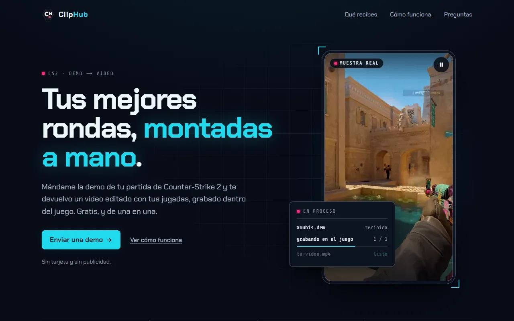

# ClipHub 🎬: Counter-Strike 2 demo in, edited video out

[](https://github.com/rechedev9/cliphub/releases/latest)
[](go.mod)


ClipHub Studio is a Windows desktop app for Counter-Strike 2 players and creators. Give it a demo and it finds your plays, records them inside the real game and edits them into a vertical Short or a long 16:9 video. It is Luis Reche's own product, shared with the agency [SocialPro](https://socialpro.es). It has 100+ users and 130+ [releases](https://github.com/rechedev9/cliphub/releases). The app interface is in Spanish.



Live site: [cliphub.rechedev.cloud](https://cliphub.rechedev.cloud/)

## Install

1. Download `ClipHub.Studio.Setup.<version>.exe` from the [latest release](https://github.com/rechedev9/cliphub/releases/latest). Each release also lists `SHA256SUMS.txt`.
2. Run it. The installer is unsigned, so Windows SmartScreen may show "Windows protected your PC". Choose **More info**, then **Run anyway**.
3. Open ClipHub Studio. The app fetches the tools it needs on its own: HLAE, FFmpeg and yt-dlp.

Requirements:

- Windows 10 or 11, 64-bit.
- Steam with Counter-Strike 2 installed. Capture runs CS2 on your own machine, so a dedicated GPU gives the cleanest result.
- About 1 GB of free disk space.

The app updates itself from the latest GitHub Release.

## Quick start

1. Open the section for the format you want: **Shorts** (9:16) or **Vídeos largos** (16:9).
2. Add the match. Drop a `.dem`, `.dem.zst`, `.zip` or `.rar` file (up to 10 demos at once), or paste a `CSGO-` share code and download the demo from Steam.
3. Pick the player. ClipHub reads the demo and lists the ten players with rating, ADR, KAST and HS %.
4. For a Short, work through four steps: plays, style, music, text and graphics. **Auto: mejores 60 s** picks the best minute for you.
5. Create the video. Studio opens CS2, records the plays through HLAE and edits them together.
6. Open the finished video in **Resultados**. The publish assistant prepares title, description and tags, and lets you download the MP4 and open YouTube Studio to upload it yourself.

## What you can do

| Section in the app | What it does |
| --- | --- |
| Shorts | Make vertical Shorts from a demo. |
| Vídeos largos | Make a full-match video from a demo. Several demos of one best-of are grouped as a series. |
| Resultados | Every video you made, with download and the publish assistant. |
| Clips de stream | Cut moments from a Twitch, YouTube or Kick link or an MP4 into vertical Shorts, with facecam framing. |
| Jugadores | Follow FACEIT players and turn their matches into clips. |
| Táctica | Round classification, a 2D replay and tendencies, all derived from the demo. |
| Anti-cheat | CheaterDetect compares each player's aim, information and reaction times with a measured baseline. It flags what to review by hand and gives no verdict. |
| Ajustes | Get this PC ready to record and manage optional connections such as Steam and diagnostics. |

Long videos cover every round from one player's view, with a HUD, team voices, round transitions and optional intro, sponsor and outro clips. Shorts add beat-synced cuts, kill effects and transitions.

## How it works

A demo goes through three stages. Everything runs on your PC.

| Stage | What happens | Code |
| --- | --- | --- |
| Parse | Reads the demo tick by tick and builds a kill plan for the chosen player. | `cmd/zv-parser`, `internal/parser` |
| Record | Launches CS2 with HLAE and captures each play from the player's view. Windows only. | `cmd/zv-recorder`, `internal/recording` |
| Edit | Analyses the music for beats, then renders the video and the publish pack with FFmpeg. | `cmd/zv-rhythm`, `cmd/zv-editor`, `internal/editor` |

`zv-orchestrator` queues and runs these jobs behind a local API. The Next.js UI in `web/` talks to it, and the Electron shell in `desktop/` bundles both into the installer.

After a source build, `bin\zv.exe` runs the same pipeline from the command line:

```powershell
.\bin\zv.exe short <demo.dem> --prompt "<instruction>" --output-format short-9x16
```

Run `.\bin\zv.exe --help` for the other commands, or `zv workflows list` through the same binary for the named workflows.

## Run from source

Requirements: Go 1.26.10 (from `go.mod`), Node 24, pnpm 11.22.0, and Steam with CS2 for capture.

```powershell
.\scripts\build.ps1                                   # Go binaries into bin\
pnpm --dir web install --frozen-lockfile
pnpm --dir desktop install --frozen-lockfile
pnpm --dir desktop run build
pnpm --dir desktop run assemble                       # stages bin\, the web build and HLAE
$env:CLIPHUB_E2E_USER_DATA = "C:\temp\cliphub-try\$(Get-Date -f yyyyMMdd-HHmmss)"
pnpm --dir desktop exec electron scripts\isolated-userdata.cjs
```

Always start with a throwaway profile as above, never your real `%APPDATA%\cliphub-studio`. A new profile shows the first-run guide. Use demo files from outside the repo. `scripts/local-studio.ps1` is an alternative that runs the orchestrator and the web UI without Electron.

Repository layout:

| Path | Contents |
| --- | --- |
| `cmd/`, `internal/` | Go backend: orchestrator, parser, recorder, editor |
| `web/` | Studio UI (Next.js) |
| `desktop/` | Electron shell and installer build |
| `landing/` | Separate Next.js site |
| `deploy/` | Telemetry deploy files |

## Checks

```bash
go vet ./...
go test ./... -count=1 -timeout 3m
go run ./cmd/zv check
pnpm --dir web run typecheck && pnpm --dir web run lint && pnpm --dir web run test:unit
pnpm --dir desktop run typecheck && pnpm --dir desktop run lint && pnpm --dir desktop run test:unit
```

`make test` runs the Go tests and `zv check`; `make build` builds the binaries. A few Full Demo editor tests depend on the FFmpeg version, and Studio ships FFmpeg 8.1.2. There is no CI on pushes or pull requests; the release workflow runs the checks before it publishes, so run the checks for what you touched before you push. [AGENTS.md](AGENTS.md) describes how to verify a change by hand in the real app.

## Releases

Bump `desktop/package.json` and `landing/app/page.tsx`, commit `chore(release): prepare Studio X.Y.Z`, then push an annotated tag `vX.Y.Z`. The `desktop-release.yml` workflow builds the unsigned Windows installer and publishes the GitHub Release that the in-app updater reads.

## Documentation

| File | Topic |
| --- | --- |
| [AGENTS.md](AGENTS.md) | Layout, build, checks, manual verification and releases |
| [docs/incidents.md](docs/incidents.md) | Domain rules and the incidents behind them |
| [docs/custom-hud.md](docs/custom-hud.md) | Custom broadcast HUDs |
| [docs/full-demo-simple-ux.md](docs/full-demo-simple-ux.md) | The long-video form and its choices |
| [docs/full-demo-overlays.md](docs/full-demo-overlays.md) | Roster and scoreboard overlays |
| [docs/full-demo-transitions.md](docs/full-demo-transitions.md) | Round transitions |
| [docs/full-demo-bumpers.md](docs/full-demo-bumpers.md) | Intro, sponsor and outro clips |
| [docs/long-video-publish-templates.md](docs/long-video-publish-templates.md) | Preparing a long video for YouTube (Spanish) |
| [docs/remote-error-diagnostics.md](docs/remote-error-diagnostics.md) | Remote error events |
| [docs/remote-debug-tracing.md](docs/remote-debug-tracing.md) | Remote debugging and trace delivery |
| [docs/experiments/webmcp-local.md](docs/experiments/webmcp-local.md) | Local WebMCP preview (Spanish) |
